  

  # Awesome Multi-Channel Marketplace Management

  
  
  
  

  **A curated directory of enterprise SaaS platforms, product feed management engines, and open-source order orchestration systems for multi-channel ecommerce across Amazon, Walmart, eBay, TikTok Shop, Etsy, and global marketplaces.**

  [Sector Overview](#sector-overview--market-dynamics) • [SaaS Platforms](#saashosted-platforms) • [Open-Source Projects](#open-source-github-projects) • [Key Capabilities](#core-capabilities-in-multichannel-management) • [Contributing](#how-to-contribute)

---

## Sector Overview & Market Dynamics

The global multi-channel order and marketplace management software market is valued at approximately **$4.2 billion to $4.5 billion**, expanding at a 10%–12% CAGR toward an estimated $7B–$11B by the early 2030s. The sector remains **moderately fragmented**: the top five global enterprise software suites account for roughly 32%–38% of revenue, while a dynamic tier of specialist feed optimization platforms and regional connector middleware serves merchants navigating fragmented seller APIs, local marketplaces, and emerging social shopping channels.

---

## SaaS/Hosted Platforms

The table below lists leading commercial multi-channel marketplace and feed management platforms, sorted in descending order by parent company scale (market capitalization, valuation, or estimated annual revenue):

| Platform | Company Scale / Valuation | Starting Tier Pricing | Free Tier / Trial Limits | Core Multi-Channel Capabilities |
| :--- | :--- | :--- | :--- | :--- |
| **[Shopify Marketplace Connect](https://help.shopify.com/en/manual/online-sales-channels/marketplaces/marketplace-connect)** | ~$215B Market Cap (Shopify Inc., NYSE: SHOP) | $0/mo base; 1% fee on sales for orders beyond the 50th order (capped at $99/mo max) | **Free Forever Plan**: 50 marketplace-synced orders/month + unlimited manual imports | Native Shopify channel app linking catalog items to Amazon, eBay, Walmart, and Target Plus via SKU/UPC matching with auto inventory sync. |
| **[ChannelAdvisor (Rithum)](https://www.rithum.com/)** | ~$1.5B+ Valuation (Rithum / Clearlake & GTCR portfolio) | ~$1,500/mo to $2,000/mo minimum platform fee + 2%–4% GMV revenue share (custom contract) | **No Free Tier / No Trial**: Live custom enterprise product demonstration only | Enterprise algorithmic Buy Box repricing for Amazon & Walmart, automated deal planning across 50+ channels, and multi-node 3PL routing. |
| **[Feedonomics](https://feedonomics.com/)** | $145M Acquisition by BigCommerce (NASDAQ: BIGC) | $29/mo (Feedonomics Surface for BigCommerce); Full-Service Enterprise starts ~$1,000/mo | **Free Tier Available**: Feedonomics Surface basic tier includes up to 100,000 SKUs on core advertising channels | Enterprise product feed transformation, category attribute enrichment, algorithmic error governance, and automated channel syndication. |
| **[SellerCloud](https://www.sellercloud.com/)** | $110M–$130M Acquisition by Descartes (NASDAQ: DSGX) | $1,349/mo (Essentials plan, billed annually) | **No Free Tier / No Trial**: Personalized live demo workflow with an integration specialist | Channel-specific virtual warehouse routing, Skustack WMS integration, catalog publishing, and consolidated marketplace inventory synchronization. |
| **[ChannelEngine](https://www.channelengine.com/)** | $57.4M Raised / ~$46.8M Est. Revenue | Custom enterprise quote; baseline packages typically require €175K monthly GMV threshold (1-year annual contract) | **No Free Tier / No Trial**: Consultation & guided demonstration only | Connects store catalogs to 700+ global marketplaces (Zalando, Bol, Amazon, Cdiscount) with AI category taxonomy mapping and Buy Box repricers. |
| **[Sellbrite](https://www.sellbrite.com/)** | GoDaddy subsidiary / ~$10M–$15M Est. Revenue | $29/mo (Pro 100 plan for up to 100 orders/month) | **Free Forever Plan**: 30 orders/month across all channels with full listing and inventory sync | Multi-channel listing templates, auto-suggested marketplace item specifics, order management, and FBA multi-channel fulfillment sync. |
| **[CedCommerce](https://cedcommerce.com/)** | ~$9.1M–$14.6M Est. Revenue | $19/mo (Beginner tier on Shopify/WooCommerce channel apps) | **Free Forever Plan**: Up to 50 orders/month & 100 products (7 to 14-day free trial on select enterprise modules) | Official Salesforce Commerce Cloud Link partner and multi-platform extension provider for TikTok Shop, Walmart, Amazon, and Etsy. |
| **[Zentail](https://www.zentail.com/)** | $6.2M Raised / ~$2.5M–$3M Est. Revenue | $300/mo (Base plan for emerging channels) | **No Free Tier / No Trial**: Occasional first-month platform fee promotion upon annual agreement | AI-driven SMART Types product catalog mapping, channel-specific listing overrides, oversell defense, and warehouse priority routing. |
| **[GoDataFeed](https://www.godatafeed.com/)** | ~$2M Est. Revenue | $39/mo (Lite plan for 1,000 SKUs & 1 channel; +$5/mo per 1K additional SKUs) | **14-Day Free Trial**: Full feature access across plans (payment method required at signup) | FeedPilot rule engine providing attribute concatenation, custom regex text replacements, dynamic margin additions, and UTM tracking injection. |
| **[ChannelSale](https://apps.shopify.com/channelsale)** | ~$1.7M Est. Revenue | $19/mo (Entry sync plan for 100 orders/month) | **Free Forever Plan**: Up to 15 orders/month and 500 product listings across Amazon, eBay, and Walmart | Connects to 200+ marketplaces with managed onboarding, catalog optimization, and multi-channel inventory/tracking synchronization. |

---

## Open-Source GitHub Projects

Multi-channel marketplace management remains an area where open-source software is scarce at the native category-mapping and feed-transformation layer. However, several open-source order orchestration systems, headless commerce platforms, and marketplace API client libraries power production-grade self-hosted multichannel architectures.

Sorted in descending order by GitHub star count:

| Repository | GitHub Stars | License | Primary Architectural Role |
| :--- | :--- | :--- | :--- |
| **[bagisto/bagisto](https://github.com/bagisto/bagisto)** |  | MIT | Enterprise-scale multi-vendor marketplace engine and headless commerce framework supporting 10M+ SKUs and multi-channel store instances. |
| **[spree/spree](https://github.com/spree/spree)** |  | BSD-3-Clause | Omnichannel headless commerce platform providing unified REST/GraphQL APIs, multi-store data tenancy, and inventory multi-location management. |
| **[reactioncommerce/reaction](https://github.com/reactioncommerce/reaction)** |  | Apache-2.0 | API-first commerce engine built with Node.js, GraphQL, and microservices for routing real-time checkout orders across dispersed sales endpoints. |
| **[aimeos/aimeos](https://github.com/aimeos/aimeos)** |  | LGPL-3.0 | Ultra-fast modular ecommerce framework supporting B2B multi-store catalogs, complex marketplace hierarchies, and ERP inventory sync feeds. |
| **[pimcore/pimcore](https://github.com/pimcore/pimcore)** |  | GPL-3.0 | Centralized Product Information Management (PIM) and Master Data Management (MDM) engine used to model, transform, and export product feeds. |
| **[openshiporg/openship](https://github.com/openshiporg/openship)** |  | MIT | Dedicated multi-channel order router linking stores (Shopify, WooCommerce, Amazon, eBay) to 3PL and supplier fulfillment destinations. |
| **[akeneo/pim-community-dev](https://github.com/akeneo/pim-community-dev)** |  | OSL-3.0 | Open-source PIM platform enabling multichannel merchants to standardize attributes, localize descriptions, and export clean feeds to channels. |
| **[saleweaver/python-amazon-sp-api](https://github.com/saleweaver/python-amazon-sp-api)** |  | MIT | Python client wrapper for the Amazon Selling Partner API (SP-API) covering Orders, Feeds, Reports, Listings Items, Pricing, and Merchant Fulfillment. |
| **[jlevers/selling-partner-api](https://github.com/jlevers/selling-partner-api)** |  | MIT | Complete PHP client SDK for Amazon SP-API with auto token refresh, rate-limit handling, and feed document encryption/decryption. |
| **[lineofflight/peddler](https://github.com/lineofflight/peddler)** |  | MIT | Robust Ruby interface for Amazon Selling Partner APIs designed for high-concurrency order harvesting and catalog feed generation. |
| **[openoms-org/openoms](https://github.com/openoms-org/openoms)** |  | ELv2 / MIT SDKs | Order Management System backend (Go + Next.js) featuring 460+ endpoints and SDKs for Allegro, Amazon SP-API, WooCommerce, and eBay. |

---

## Core Capabilities in Multi-Channel Management

1. **Catalog & Feed Transformation**: Harmonizing master SKU attributes into marketplace-specific taxonomies (e.g., Google Shopping RSS, Amazon SP-API JSON, Walmart Spec 4.0).
2. **Real-Time Inventory Synchronization**: Bi-directional inventory buffer management that instantly decrements stock across all connected channels to eliminate out-of-stock cancellations.
3. **Algorithmic Repricing & Buy Box Optimization**: Dynamic price adjustments responding to competitor pricing, seller rating thresholds, and shipping velocity.
4. **Intelligent Order Routing & Split Fulfillment**: Routing orders dynamically to optimal fulfillment nodes (FBA, internal warehouses, 3PL logistics, or dropship suppliers).

---

## How to Contribute

Contributions are welcome! Please follow these guidelines:

1. **Fork** this repository.
2. Create a topic branch (`git checkout -b feature/add-new-channel-tool`).
3. Add verified SaaS platforms or open-source projects (include official documentation links, exact starting pricing, or active GitHub repo metrics).
4. Verify all markdown tables and links render cleanly.
5. Submit a **Pull Request** with a brief summary of the added solution.

---

## Disclaimer

- This repository is a community-curated educational index and does not represent an endorsement or commercial partnership.
- Multi-channel operations must adhere to marketplace API acceptable use policies, rate limits, and brand safety guidelines.
- Always review repository licensing before incorporating code into commercial environments.

---

  Maintained for ecommerce engineers, omnichannel architects, and marketplace operations specialists.

